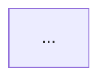

# Code Shine — Shared Framework

Code quality diagnosis framework for 20+ programming languages.
Codex CLI uses this shared framework via the `skills/codex-*/SKILL.md` entry points.

## The Iron Law

```
NEVER suggest fixes before completing risk diagnosis.
EVERY finding must follow: Symptom → Source → Consequence → Remedy.
```

Violating this law produces reviews that list rule violations without explaining why they
matter. A finding without a consequence and a remedy is not a finding — it is noise.

> **On-demand sections (skip unless the condition applies):**
> - "Remedy Mode" — only when user passes `--fix` or asks to fix findings
> - "Post-Report Triage" — only in interactive sessions after the report is output
> - "History Tracking" — only after the Health Score is computed

## Project Config

Before executing the review, attempt to read `.code-shine.yaml` from the project root.
If the file exists, parse and apply its settings before proceeding.
If the file does not exist, continue with defaults (all risks enabled, no ignores).

In a multi-mode session, re-read only if the user says the config has changed.

### Supported settings

**`disable`** — list of risk codes to skip entirely. Findings for disabled risks are
silently omitted from the report and do not affect the Health Score.
Valid codes: `R1` `R2` `R3` `R4` `R5` `R6` `T1` `T2` `T3` `T4` `T5` `T6`

**`severity`** — override the severity of a specific risk for this project.
Valid values: `critical` `warning` `suggestion`
Example: `R1: suggestion` means every R1 finding is downgraded to Suggestion regardless
of what the guide says.

**`ignore`** — list of glob patterns. Files matching any pattern are excluded from
analysis. Findings that arise solely from ignored files are omitted.
Common entries: `**/*.generated.*`, `**/vendor/**`, `**/migrations/**`

**`focus`** — non-empty list of risk codes to evaluate; all others are skipped.
Omit this key (or leave it empty) to evaluate all non-disabled risks.
Cannot be combined with a non-empty `disable` list.

**`languages`** — restrict analysis to a subset of supported languages.
When omitted, the tool auto-detects the project's primary languages from file extensions.
Example: `languages: [python, typescript, go]`

**`strictness`** — tune how harshly findings are scored, for teams at different
maturity stages. One of:
- `strict` — heavier deductions; for teams holding a high bar.
- `balanced` — the default, used when the key is absent.
- `legacy-friendly` — lighter deductions, and the Summary leads with the three
  highest-leverage fixes so a legacy codebase's first run is not a demoralizing
  wall of Criticals. Every finding is still reported — only the score and framing soften.

See **Health Score Calculation** below for the per-preset deduction weights.

**Minimal example:**
```yaml
version: 1
strictness: legacy-friendly
languages: [python, typescript, go, rust]
disable:
  - T5
severity:
  R1: suggestion
ignore:
  - "**/*.generated.*"
```

If `.code-shine.yaml` contains a `custom_risks` map, read `custom-risks-guide.md`
from the `_shared/` directory for loading and scanning instructions.

### Config Validation

Before applying, check for errors and mention each in the report:
- Invalid risk code (not R1–R6, T1–T6, or a defined `Cx` code): skip it, note `"Config warning: X is not a valid risk code"`
- Invalid severity value (not `critical`/`warning`/`suggestion`): skip it, note the error
- Both `disable` and `focus` are non-empty: treat as a config error, ignore both, note it
- Invalid `strictness` value (not `strict`/`balanced`/`legacy-friendly`): fall back to `balanced`, note the error
- Unknown language in `languages:`: skip it, note the error

If the YAML fails to parse entirely, skip config loading and proceed with defaults.

### Config Reporting

If a config file was found and applied, add this line immediately after the **Scope** line
in the report:
`Config: .code-shine.yaml applied (strictness: <preset>, N risks disabled, M paths ignored)`

Use `balanced` for `<preset>` when `strictness` is unset. Include N and M even if zero.
Omit this line if no config file was found.

---

## Auto Scope Detection

When no files or code are specified, detect scope automatically:

**PR Review:** `git diff --cached` → `git diff` → `git diff main...HEAD` → ask user.

**Architecture Audit / Tech Debt:** Entire project by default. `--since=<ref>`: run `git diff <ref>...HEAD --name-only`, analyze only modules containing changed files; note "Incremental audit — modules touched since <ref>".

**Test Quality:** All test files by default. If a diff exists, prioritize test files co-located with changed production files (`src/foo.ts` → `src/foo.test.ts`).

**Health Dashboard:** Entire project by default. If user provides a path, scope all dimension sub-scans to that path.

**Scope line:** Always state what was detected — e.g., `Scope: staged changes (3 files)` or `Scope: branch changes vs main (12 files)`.

---

## Language Detection & Coverage

Code Shine recognizes 20+ programming languages and applies language-specific checks when possible.
Generic rules apply across all languages; language-specific extensions activate per file extension.

| Family | Languages (file extensions) |
|--------|------------------------------|
| C-family | C (.c, .h), C++ (.cpp, .cc, .hpp, .hxx), C# (.cs), Objective-C (.m, .mm), Java (.java), Kotlin (.kt), Scala (.scala) |
| Systems | Rust (.rs), Go (.go), Swift (.swift), Zig (.zig) |
| Web | TypeScript (.ts, .tsx), JavaScript (.js, .jsx, .mjs, .cjs), HTML (.html), CSS (.css, .scss, .sass, .less) |
| Scripting | Python (.py, .pyi), Ruby (.rb), PHP (.php), Perl (.pl), Lua (.lua), Bash/Shell (.sh, .bash, .zsh) |
| Functional | Haskell (.hs), Elixir (.ex, .exs), Erlang (.erl), Clojure (.clj), F# (.fs), OCaml (.ml) |
| Data / Config | SQL (.sql), YAML (.yaml, .yml), TOML (.toml), JSON (.json), XML (.xml), Markdown (.md) |
| Other | Dart (.dart), R (.r, .R), Julia (.jl), MATLAB (.m) |

If a file extension is unknown, treat the file as a generic source text — generic risk rules still apply, but language-specific rules are skipped.

---

## The Six Decay Risks

Navigation index only — canonical definitions (symptoms, severity guides, sources, "What Not
to Flag" guards) live in `decay-risks.md`. Do not duplicate or edit diagnostic questions here;
update `decay-risks.md` directly.

| Code | Risk | Diagnostic Question |
|------|------|---------------------|
| R1 | Cognitive Overload | How much mental effort to understand this? |
| R2 | Change Propagation | How many unrelated things break on one change? |
| R3 | Knowledge Duplication | Is the same decision expressed in multiple places? |
| R4 | Accidental Complexity | Is the code more complex than the problem? |
| R5 | Dependency Disorder | Do dependencies flow in a consistent direction? |
| R6 | Domain Model Distortion | Does the code faithfully represent the domain? |

---

## Report Template

**Language rule:** Output the report in the same language the user is using. Translate the
per-finding content and the one-sentence verdict to match the user's language. Keep the
following in English: Iron Law field labels (Symptom / Source / Consequence / Remedy),
principle and smell names (e.g. "Shotgun Surgery", "Divergent Change"),
and fixed structural headers from the template below (`Findings`, `Summary`,
`Module Dependency Graph`, `Critical`, `Warning`, `Suggestion`).

````
# Code Shine Review

**Mode:** [PR Review / Architecture Audit / Tech Debt Assessment / Test Quality Review]
**Languages:** [auto-detected or from config]
**Scope:** [file(s), directory, or description of what was reviewed]
**Health Score:** XX/100

[One sentence overall verdict]

---

## Module Dependency Graph

<!-- Mode 2 (Architecture Audit) ONLY — omit this section for other modes -->
<!-- classDef colors: see architecture-guide.md Step 1 Rule 6 -->



---

## Findings

<!-- Sort all findings by severity: Critical first, then Warning, then Suggestion -->
<!-- If no findings in a severity tier, omit that tier's heading -->

### 🔴 Critical

**[Risk Name] — [Short descriptive title]**
Symptom: [exactly what was observed in the code]
Source: [principle or smell name, e.g. "Refactoring — Long Method"]
Consequence: [what breaks or gets worse if this is not fixed]
Remedy: [concrete, specific action]

### 🟡 Warning

**[Risk Name] — [Short descriptive title]**
Symptom: ...
Source: ...
Consequence: ...
Remedy: ...

### 🟢 Suggestion

**[Risk Name] — [Short descriptive title]**
Symptom: ...
Source: ...
Consequence: ...
Remedy: ...

---

## Summary

[2–3 sentences: what is the most important action, and what is the overall trend]
````

## Remedy Mode

When the user passes `--fix` or asks to "fix the findings", read
`remedy-guide.md` from the `_shared/` directory before writing the report.

## Health Score Calculation

Base score: 100. Per-finding deductions depend on the `strictness` preset
(`balanced` is used when no preset is set):

| Preset | 🔴 Critical | 🟡 Warning | 🟢 Suggestion |
|--------|------------|-----------|--------------|
| `strict` | −20 | −8 | −2 |
| `balanced` (default) | −15 | −5 | −1 |
| `legacy-friendly` | −8 | −3 | −1 |

Floor: 0 (score cannot go below 0). The preset changes only the score weighting and
framing — every finding is still reported in full. Under `legacy-friendly`, lead the
**Summary** with the three highest-leverage fixes so a first run is not a wall of Criticals.

## History Tracking

After generating the Health Score, attempt to append a record to `.code-shine-history.json`
in the project root.

**Append logic:**
1. Read the file (or start with empty array if it doesn't exist)
2. Append: `{ date, mode, languages, score, findings: { critical, warning, suggestion }, scope }`
3. Write the file back

**Trend display:** If the history file exists and contains at least one prior record for
the same mode, add a Trend line after the Health Score in the report:

  **Trend:** 85 → 82 (−3) over last 3 runs

Show the most recent prior score and the delta. If delta is 0: "Stable at 82".
If this is the first run for this mode: "First run — no trend data".

## Post-Report Triage (Optional)

**Guard:** Interactive sessions only — skip in CI/headless mode.

After reporting Warning or Suggestion findings, offer:
> Would you like to triage these findings? (accept / dismiss / defer / skip)

For each finding one at a time (lowest severity first): show title, ask `[a]ccept / [d]ismiss / [f]defer / [s]skip`; wait for reply before moving to the next.

**Dismiss:** ask one-line reason → append to `.code-shine.yaml` under `suppress:` → downgraded to info in future runs.

**Defer:** same as dismiss, add `expires: YYYY-MM-DD` (default 90 days) → resurfaces at original severity after expiry.

**Suppress matching at scan time:** for each `suppress:` entry, match `risk` code and file `pattern` against findings.
- Both match → downgrade to info (not counted in Health Score, shown under collapsed "Suppressed" section).
- `expires` is past → ignore entry, finding resurfaces. Note in Summary: "N suppressed findings have expired and are now active again."

## Reference Files

Read on demand:

| File | When to Read |
|------|-------------|
| `decay-risks.md` | Before any production-code review or architecture/debt assessment |
| `test-decay-risks.md` | Before any test review and before the PR Review "Quick Test Check" step |
| `language-rules.md` | When language-specific checks need to be applied |
| `remedy-guide.md` | When `--fix` is requested |
| `custom-risks-guide.md` | When `.code-shine.yaml` defines `custom_risks` |
